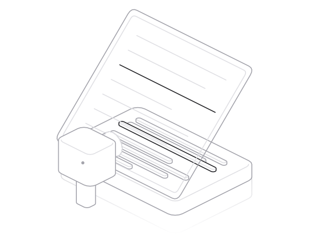

<picture>
  <source media="(prefers-color-scheme: dark)" srcset="docs/assets/hero-dark.svg">
  
</picture>

<p align="center">
  <b>A teleprompter that opens in the browser and handles like a device.</b><br>
  Paste your script, edit it right on the screen, tune type and speed, and record.
</p>

<p align="center">
  <a href="https://teleprompter-1cq.pages.dev"></a>
  
  
  
</p>

<p align="center"><a href="README.md">Español</a></p>

---

The interface is in Spanish; the full documentation lives in [`docs/`](docs) (Spanish).

## What it does

- **Write or paste** the script in Settings, or double-click the prompter and type straight onto it — line breaks and spaces included.
- **Tune reading**: font size, line height, column width, typeface, weight, alignment, uppercase, colours and theme (Carbón, Papel, Blanco).
- **Set the pace**: speed, reading-line height, and a 3, 5, 10 or 15 second countdown.
- **Record**: the text scrolls by itself, the controls hide, and the screen stays awake. Arrow keys change speed or jump back without stopping.
- **Mirror mode** for beam-splitter glass, horizontal and vertical.

Script and settings are kept in your browser's `localStorage`. No accounts, no server, no tracking.

## Keys

| Key | Action |
|---|---|
| <kbd>Space</kbd> | Start / pause |
| <kbd>↑</kbd> <kbd>↓</kbd> | Speed |
| <kbd>←</kbd> <kbd>→</kbd> | Back / forward three lines |
| <kbd>+</kbd> <kbd>−</kbd> | Font size |
| <kbd>T</kbd> or double-click | Edit on screen (<kbd>Esc</kbd> to finish) |
| <kbd>E</kbd> · <kbd>M</kbd> · <kbd>R</kbd> · <kbd>F</kbd> | Settings · mirror · restart · fullscreen |

## Design and illustration

The UI follows **[Frekvens](https://github.com/olmedcr-cmyk/frekvens)**, Cris Olmedo's design system: big keys, one number in charge, circles and dots on an exact grid, Archivo + Doto + IBM Plex Mono. The header is a **[Hairline](https://github.com/lucasmarkes/hairline)** figure that answers the pointer — try it at [/hairline.html](https://teleprompter-1cq.pages.dev/hairline.html).

## Run it

```bash
git clone https://github.com/olmedcr-cmyk/teleprompter.git && cd teleprompter
make dev     # http://localhost:8765
```

It is a single HTML file (`public/index.html`); opening it directly works too. Deploy with `make deploy` (Cloudflare Pages via wrangler).

## License

[MIT](LICENSE) © 2026 Cris Olmedo. Third-party credits in [NOTICE.md](NOTICE.md).
