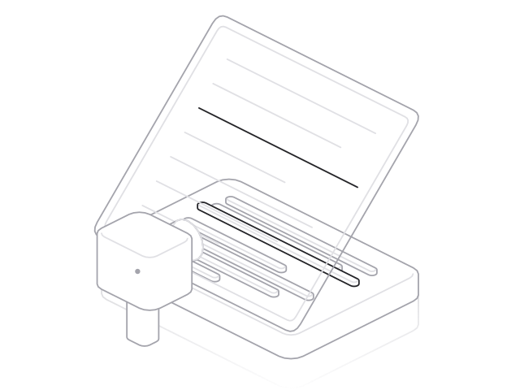
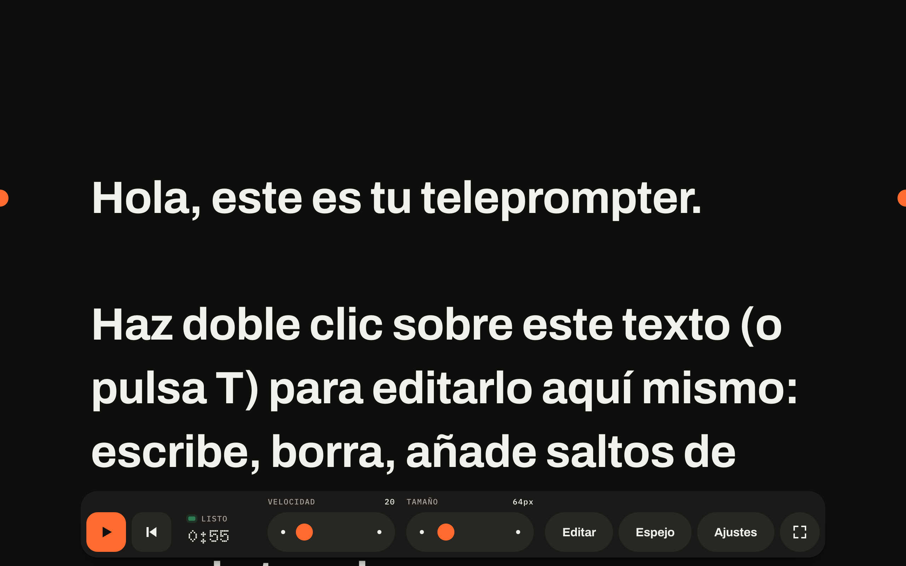
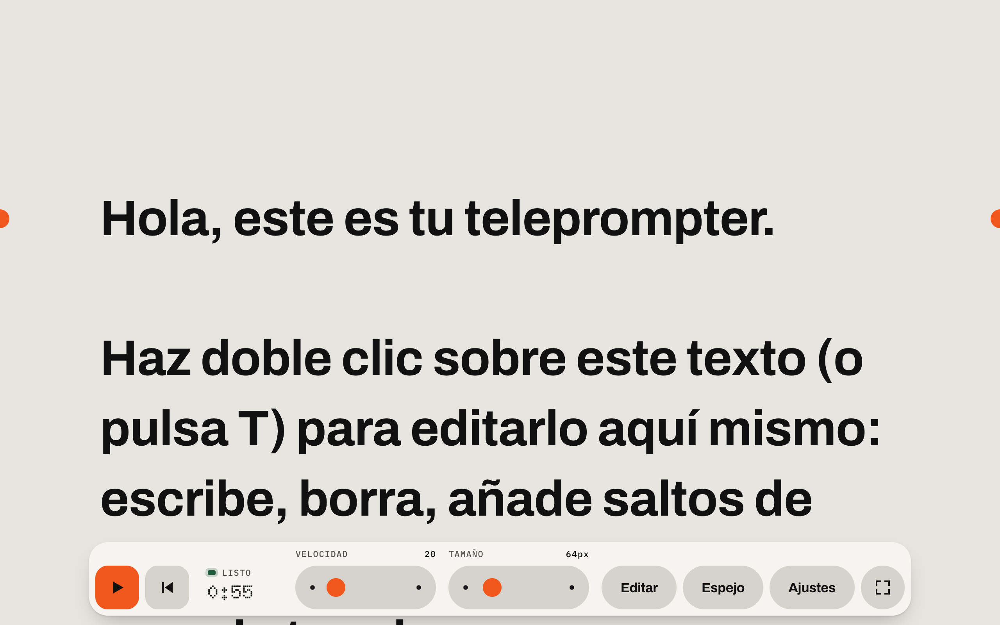
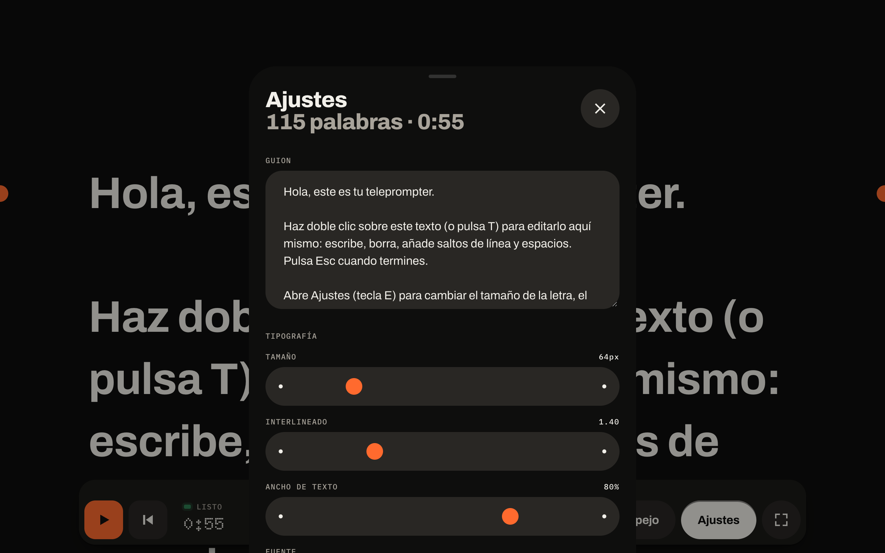
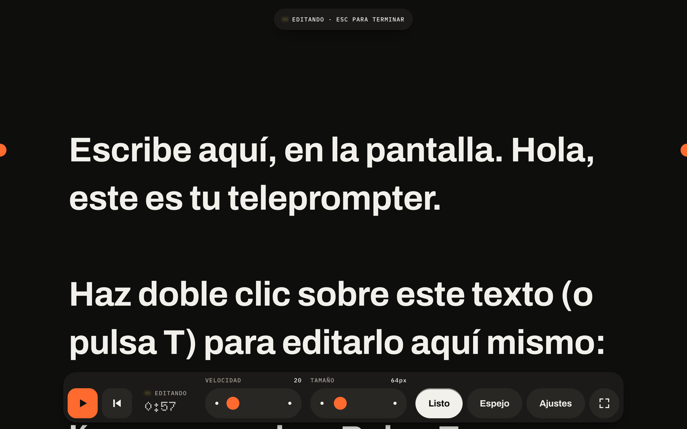
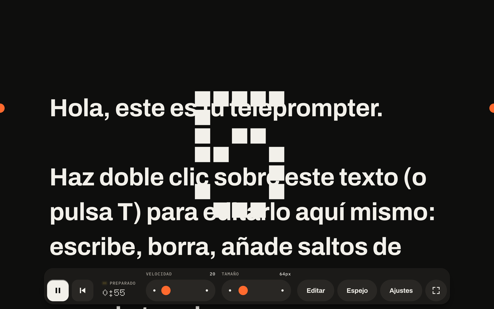
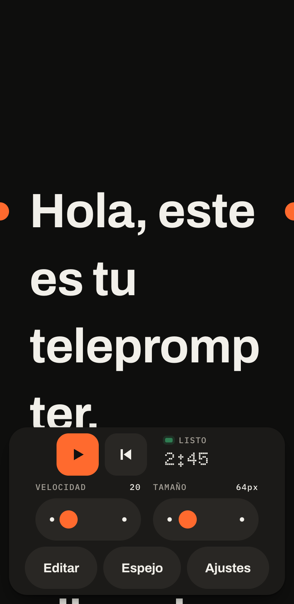

<picture>
  <source media="(prefers-color-scheme: dark)" srcset="docs/assets/hero-dark.svg">
  
</picture>

<p align="center">
  <b>Un teleprompter que se abre en el navegador y se maneja como un aparato.</b><br>
  Pegas el guion, lo editas sobre la propia pantalla, ajustas letra y velocidad, y grabas.
</p>

<p align="center">
  <a href="https://teleprompter-1cq.pages.dev"></a>
  
  
  
  
  
</p>

<p align="center">
  <a href="README.en.md">English</a> ·
  <a href="docs/01-uso.md">Uso</a> ·
  <a href="docs/02-diseno.md">Diseño</a> ·
  <a href="docs/03-arquitectura.md">Arquitectura</a> ·
  <a href="docs/04-despliegue.md">Despliegue</a> ·
  <a href="docs/05-hairline.md">Hairline</a>
</p>

---

## Qué hace

1. **Pegas o escribes el guion**, en Ajustes o directamente sobre la pantalla con doble clic: saltos de línea y espacios incluidos.
2. **Ajustas la lectura**: tamaño de letra, interlineado, ancho de columna, fuente, grosor, alineación, mayúsculas, colores y tema.
3. **Eliges el ritmo**: velocidad, altura de la línea de lectura y una cuenta atrás de 3, 5, 10 o 15 segundos.
4. **Grabas**: el texto sube solo, los mandos se esconden y la pantalla no se apaga. Con flechas cambias la velocidad o saltas atrás sin parar.
5. **Si usas cristal**, el modo espejo invierte el texto en horizontal (y en vertical, si tu montaje lo pide).

Todo queda guardado en tu navegador: el guion y los ajustes siguen ahí la próxima vez. No hay cuentas, servidor ni seguimiento.

## Capturas

| Carbón | Papel |
|:--:|:--:|
|  |  |

| Ajustes | Editar en pantalla | Cuenta atrás |
|:--:|:--:|:--:|
|  |  |  |

<p align="center"></p>

## Atajos

| Tecla | Qué hace |
|---|---|
| <kbd>Espacio</kbd> | Empieza o pausa (con la cuenta atrás que hayas elegido) |
| <kbd>↑</kbd> <kbd>↓</kbd> | Cambia la velocidad mientras lees |
| <kbd>←</kbd> <kbd>→</kbd> | Retrocede o avanza tres líneas |
| <kbd>+</kbd> <kbd>−</kbd> | Cambia el tamaño de letra |
| <kbd>T</kbd> o doble clic | Edita el texto en pantalla; <kbd>Esc</kbd> para terminar |
| <kbd>E</kbd> | Abre Ajustes |
| <kbd>M</kbd> | Espejo |
| <kbd>R</kbd> | Vuelve al inicio |
| <kbd>F</kbd> | Pantalla completa |

Con ratón o dedo: un toque inicia o pausa, arrastrar mueve el texto y la rueda también. Más en [docs/01-uso.md](docs/01-uso.md).

## Diseño: Frekvens

La interfaz usa **[Frekvens](https://github.com/olmedcr-cmyk/frekvens)**, el sistema de diseño de Cris Olmedo: las pantallas se manejan como un aparato, con teclas grandes, un número que manda y círculos sobre una retícula exacta.

- **Botonera** de teclas de 56 px como mínimo; la de empezar en **naranja Rams**, porque arranca algo físico.
- **Piloto LED** con una palabra: Listo, Preparado, Leyendo, Pausa, Editando, Fin.
- **Doto** para las cifras de máquina (tiempo restante, cuenta atrás), **Archivo** para leer, **IBM Plex Mono** para las etiquetas.
- **Temas** Carbón, Papel y Blanco. Las marcas de la línea de lectura son dos discos: en Frekvens, el círculo es la unidad.

El detalle, con lo que se tomó y dónde se aparta, está en [docs/02-diseno.md](docs/02-diseno.md).

## Ilustración: Hairline

La cabecera es una figura **[Hairline](https://github.com/lucasmarkes/hairline)**: un dibujo isométrico de líneas que responde al puntero. Un monitor boca arriba bajo un cristal a 45°, con la cámara detrás; la línea del guion que señalas sube y se enciende en la pantalla y en el cristal. Pruébala en **[/hairline.html](https://teleprompter-1cq.pages.dev/hairline.html)**. Cómo está hecha: [docs/05-hairline.md](docs/05-hairline.md).

## Puesta en marcha

No hay nada que instalar: es un único archivo HTML.

```bash
git clone https://github.com/olmedcr-cmyk/teleprompter.git && cd teleprompter
make dev          # http://localhost:8765
```

Sin `make`, abre `public/index.html` en el navegador o sirve la carpeta con `python3 -m http.server -d public`.

## Estructura

```
public/
  index.html         la app entera: HTML, CSS (tokens y componentes Frekvens) y JS
  hairline.html      la figura Hairline, interactiva
  _headers           cabeceras de seguridad para Cloudflare Pages
docs/
  01-uso.md … 05-hairline.md
  assets/            cabecera SVG y capturas del README
  hairline/          el código de la figura (teleprompter.js)
scripts/
  check.mjs          comprobaciones estáticas (CI)
  capturas.mjs       regenera capturas y cabecera
.github/             CI, despliegue, plantillas de issues y PR
```

## Despliegue

La versión pública vive en **Cloudflare Pages**, proyecto `teleprompter`:

```bash
make deploy       # comprueba y sube public/ con wrangler
```

Cada push a `main` también despliega solo si el repositorio tiene los secretos `CLOUDFLARE_API_TOKEN` y `CLOUDFLARE_ACCOUNT_ID`. Paso a paso en [docs/04-despliegue.md](docs/04-despliegue.md).

## Contribuir

Lee [CONTRIBUTING.md](CONTRIBUTING.md). Los fallos de seguridad, por [SECURITY.md](SECURITY.md), nunca en un issue público. Cambios de cada versión en [CHANGELOG.md](CHANGELOG.md).

## Licencia

[MIT](LICENSE) © 2026 Cris Olmedo. Créditos de terceros (Hairline, tipografías) en [NOTICE.md](NOTICE.md).
