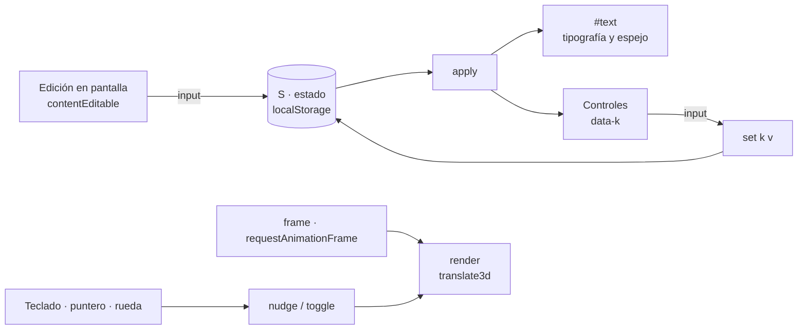

# 03 · Arquitectura

[← Diseño](02-diseno.md) · [Despliegue →](04-despliegue.md)

Un solo archivo, `public/index.html`, sin dependencias ni paso de compilación. Unas 700 líneas: tokens, componentes, escenario y lógica.

## Piezas



| Pieza | Qué hace |
|---|---|
| `S` | Todo el estado persistente: guion y ajustes. Se guarda entero en `localStorage` (`teleprompter-frekvens`) en cada cambio |
| `set(k, v)` | Cambia un ajuste, guarda y llama a `apply`. Elegir un tema también trae su tinta y su papel |
| `apply()` | Vuelca `S` en variables CSS (`--size`, `--lh`, `--width`, `--guide`, `--fg`, `--bg`), en el texto y en el estado de cada control |
| `measure()` | Calcula el recorrido (`max`) y la duración; mantiene la posición relativa al cambiar tamaño o ancho |
| `frame()` | El bucle: avanza `pos` a `pxps()` píxeles por segundo mientras `playing` |
| `render()` | Mueve el texto con `translate3d` y actualiza progreso y tiempo restante |

## Controles declarativos

Cada control lleva `data-k` con el nombre de su ajuste. Un mismo ajuste puede tener varios controles (el tamaño está en la botonera y en Ajustes): todos se sincronizan en `apply()`.

| Control | Marcado |
|---|---|
| Deslizador, select, color, textarea | `<input data-k="…">`, `<select data-k="…">`… |
| Segmentado | `.frk-seg[data-k]` con botones `data-v` |
| Interruptor | `.frk-switch[data-k]` |

Añadir un ajuste es: un valor por defecto en `DEF`, un control con `data-k` y su efecto en `apply()`.

## Velocidad

```js
pxps = speed × 0.035 × size × (lh / 1.4)
```

La velocidad se mide en líneas, no en píxeles: al agrandar la letra el texto sube más rápido en píxeles pero igual en palabras por minuto.

## Edición en pantalla

`startEdit()` pone `#text` en `contentEditable="plaintext-only"` (o `true` con pegado en texto plano donde no existe), quita el espejo y coloca el cursor donde se hizo doble clic (`caretRangeFromPoint`). Cada `input` copia el texto a `S.script`. `followCaret()` desplaza el escenario para que el cursor no salga de la vista. `stopEdit()` devuelve todo a su sitio.

## Línea de lectura

`#text` lleva un relleno superior para que la primera línea empiece en la línea de lectura (`--guide`, en % del alto), y uno inferior para que la última llegue hasta ella. Por eso el recorrido termina con la última línea en las marcas, no fuera de pantalla.

## Comprobaciones

`scripts/check.mjs` (y la CI) comprueba sin navegador que:

- los HTML de `public/` tienen doctype, `lang` y viewport, y pesan menos de 200 KB;
- no se carga nada de fuera salvo Google Fonts, y no hay scripts externos;
- cada `<script>` compila;
- existen los elementos y controles de los que depende el código.
